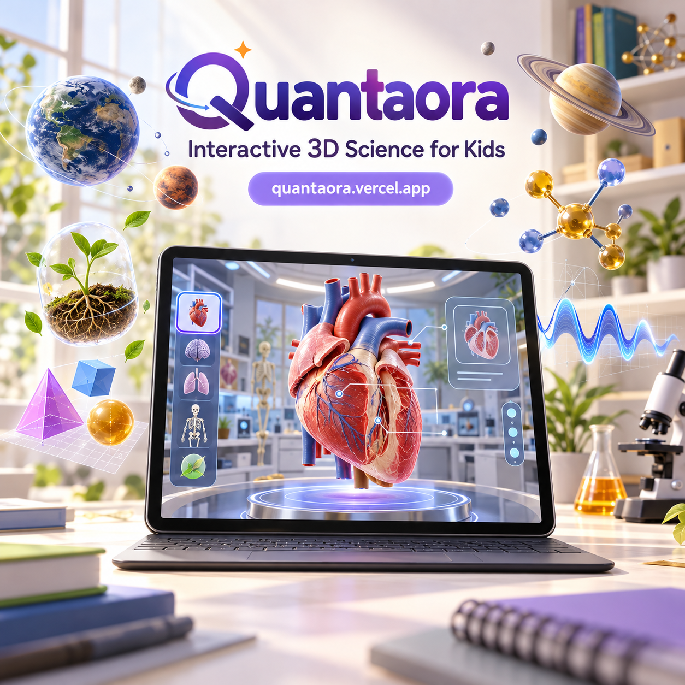

# Quantaora

[](https://github.com/ahmedjawedaj/quantaora/actions/workflows/ci.yml)
[](https://github.com/ahmedjawedaj/quantaora/actions/workflows/codeql.yml)
[](https://github.com/ahmedjawedaj/quantaora/actions/workflows/deploy-vercel.yml)
[](https://quantaora.vercel.app)
[](LICENSE)

**Interactive 3D STEM learning labs built for curious kids.**

Quantaora turns science and mathematics into things learners can inspect, manipulate, compare, and explain. Children can rotate 3D models, reveal structures, change variables, observe cause and effect, follow short lessons, complete checkpoints, and save progress locally.

[Launch Quantaora](https://quantaora.vercel.app) | [Report a bug](https://github.com/ahmedjawedaj/quantaora/issues/new?template=bug.yml) | [Propose a lab](https://github.com/ahmedjawedaj/quantaora/issues/new?template=lab-proposal.yml)



## What Learners Can Explore

- **Biology:** human anatomy, cells, physiology, plants, animals, evolution, health, neuroscience, genetics, ecology, and microbiology.
- **Physics:** mechanics, motion, forces, energy, electricity, waves, sound, fluids, and heat.
- **Chemistry:** atoms, elements, molecules, reactions, states of matter, solutions, acids and bases, and biochemistry.
- **Mathematics:** number sense, arithmetic, geometry, measurement, algebra, graphs, probability, and mathematical manipulatives.
- **Space:** the Solar System, planets, moons, stars, galaxies, Earth in space, and cosmology foundations.

Labs combine inspectable 3D scenes with kid-facing missions, guided lessons, quizzes, comparison tools, and branch-specific experiments. Examples include distinguishing rotation from revolution, changing sound frequency and amplitude, testing buoyancy, exploring heat transfer, following plant growth, and examining body systems.

## Navigate the App

1. Open the [live app](https://quantaora.vercel.app).
2. Select **Explore Labs** or open **Labs** from the main navigation.
3. Choose a subject, then a branch and learning component.
4. Use the canvas toolbar to rotate, zoom, isolate, section, compare, reset, and control available animations.
5. Open the learning tray for lessons, checkpoints, quizzes, notes, and saved progress.

The current public alpha has no account or backend requirement. Learner state is stored in the browser on the current device.

## Technology

- React 19, TypeScript, Vite, and Tailwind CSS
- Three.js, React Three Fiber, and Drei
- Zustand for application state and Dexie for local persistence
- Node's test runner, Oxlint, Playwright-based visual QA, and custom content/asset quality gates
- Vercel for production hosting

## Local Development

Prerequisites: Node.js 22 or newer and npm.

```bash
git clone https://github.com/ahmedjawedaj/quantaora.git
cd quantaora/quantaora-app
npm ci
npm run dev
```

The development server prints the local URL. No environment variables are required for the core app.

### Quality Checks

```bash
npm run lint
npm test
npm run quality:gaps
npm run assets:check
npm run build
```

Run `npm run codegen -- <branch> <subject>` after changing authored curriculum under `content/subjects/`. See [CONTRIBUTING.md](CONTRIBUTING.md) for the complete workflow.

## Repository Structure

```text
.
|-- content/                 Curriculum source files
|-- docs/                    Product, QA, authoring, and asset documentation
|-- quantaora-app/
|   |-- public/              Shipped 3D models, textures, and decoder assets
|   |-- scripts/             Code generation, QA, and asset tooling
|   `-- src/                 React application and tests
`-- scripts/                 Repository-level authoring and verification helpers
```

## Contributing

Contributions are welcome from educators, subject specialists, 3D artists, designers, accessibility reviewers, developers, parents, and testers. Good starting points include:

- Improving an existing lesson or quiz with curriculum evidence
- Adding an accessible, accurately licensed 3D model
- Creating a clear cause-and-effect experiment
- Testing a lab on mobile, keyboard, and assistive technology
- Fixing an issue labelled `good first issue`

Read [CONTRIBUTING.md](CONTRIBUTING.md), the [Code of Conduct](CODE_OF_CONDUCT.md), and the [3D asset quality gate](docs/3D-ASSET-QUALITY-GATE.md) before opening a pull request.

## Licensing and Asset Attribution

Quantaora's original source code is available under the [MIT License](LICENSE). Third-party 3D models, textures, and datasets retain their own licenses and are **not relicensed by the MIT License**. Review [docs/ASSET-LICENSES.md](docs/ASSET-LICENSES.md) and each asset's sidecar metadata before reuse.

Some anatomy models in the public alpha remain marked `REVIEW` for final provenance replacement. They are tracked openly in the asset register and must be replaced or cleared before any paid release.

## Project Status

Quantaora is an active public alpha. Functional learning coverage is broad, while visual realism, curriculum review, accessibility, performance, and cross-device testing continue to improve. The live app is suitable for exploration and feedback; it is not a substitute for formal medical or safety instruction.

## Security

Please do not disclose vulnerabilities in a public issue. Follow [SECURITY.md](SECURITY.md) to report them privately through GitHub.
